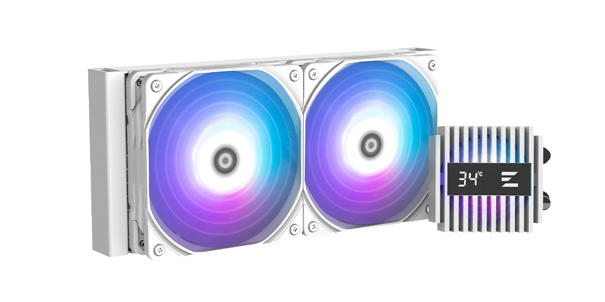

# Zalman Alpha2 A24/A36 Linux Temperature Display Driver



Userspace Python USB HID Driver and Systemd services for Zalman Alpha2 A24/A36 liquid coolers.

# Requirements

- Python 3.8+
- `python-hidapi` system package

Debian: `apt install python3 python-hidapi`

Arch: `pacman -S python python-hidapi`

# Usage

To do a quick test run:
```
./run.sh
```

To add the driver as a Systemd service on boot run:
```
# cp zalman_temp_display.py /usr/local/bin/zalman_temp_display
# cp zalman_temp_display.service zalman_temp_display.socket zalman_temp_display_writer.service /etc/systemd/system/
# systemctl daemon-reload
# systemctl enable --now zalman_temp_display.socket zalman_temp_display_writer.service
```

# Modifying displayed value

By default the Tctl value reported by lm_sensors is displayed.
You can replace it with another (e.g. Tccd1), by modifying `grep` capture in `run.sh` or `zalman_temp_display_writer.service`.